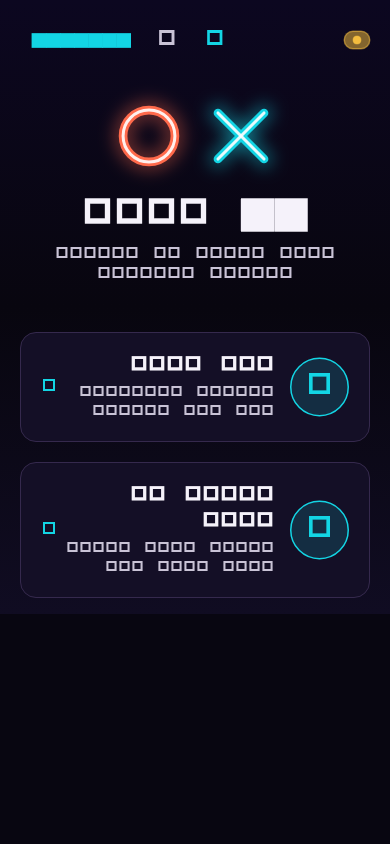
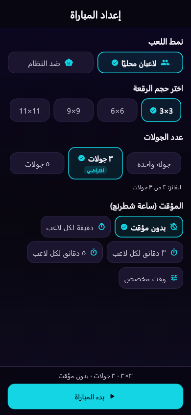
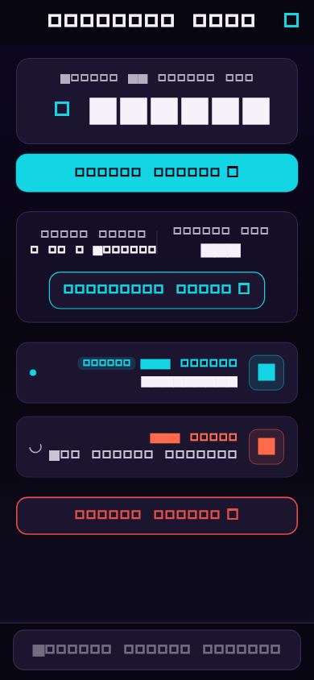
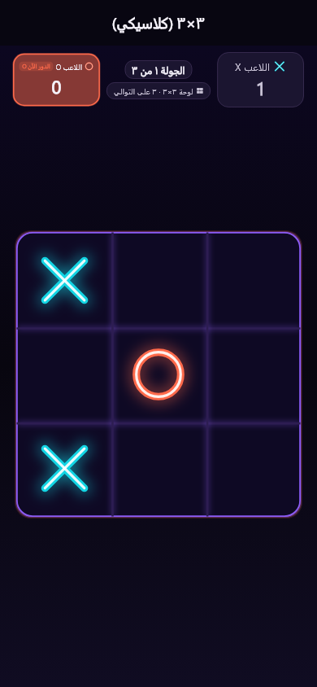
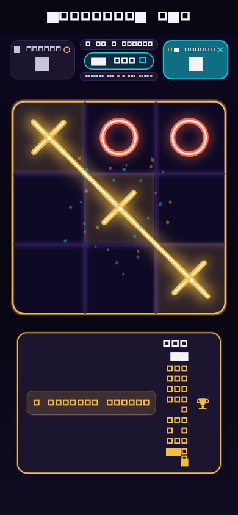
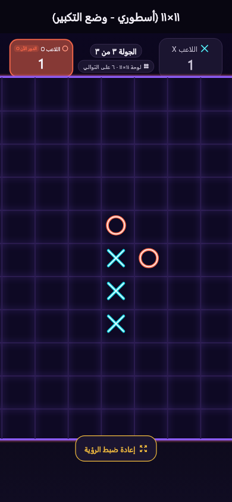

# لعبة XO نيون | XO Neon

تطبيق ترفيهي حديث للعبة إكس-أو (Tic-Tac-Toe) مبني بالكامل باستخدام Flutter، يتميز بهوية بصرية مستوحاة من ألوان النيون والتصميم المستقبلي (Cyberpunk)، مع دعم كامل للعب الفردي ضد الذكاء الاصطناعي، التحدي المحلي لشخصين على نفس الهاتف، واللعب الجماعي التفاعلي عبر الإنترنت في الوقت الفعلي.

---

## لقطات من داخل اللعبة

| الشاشة الرئيسية | إعدادات المباراة | بهو الانتظار أونلاين |
| :---: | :---: | :---: |
|  |  |  |

| الرقعة الكلاسيكية 3x3 | رقعة 6x6 مع خط الفوز | رقعة 11x11 مع ميزة التكبير |
| :---: | :---: | :---: |
|  |  |  |

---

## أبرز الخصائص

- **تصميم نيون تفاعلي:** مؤثرات ضوئية متوهجة، أصوات مخصصة للحركات، واهتزازات حسية عند النقر والفوز والتعادل.
- **تنوع أحجام الرقع:**
  - 3×3 (فوز بثلاث خانات متتالية).
  - 6×6 (فوز بأربع خانات متتالية).
  - 9×9 (فوز بخمس خانات متتالية).
  - 11×11 (فوز بست خانات مع إمكانية التكبير والتصغير للتنقل السلس).
- **أنماط لعب متعددة:**
  - **لاعب واحد ضد الذكاء الاصطناعي:** خوارزميات Minimax وتقييم هجين متقدم مع 5 مستويات صعوبة وتدرج آلي.
  - **لاعبان على نفس الجهاز:** خيار التنافس المحلي السريع مع ضبط زمن التفكير لكل دور.
  - **اللعب الجماعي أونلاين:** إنشاء غرف خاصة بمفتاح دخول مكون من 6 أحرف ومشاركتها عبر روابط دعوة سريعة.
- **استقرار المعاملات عبر الإنترنت:** معالجة ذرية لحركات اللاعبين وحالات الاتصال والانقطاع لمنع التعارض.
- **دعم كامل للغة العربية والإنجليزية:** واجهات تدعم الاتجاهين RTL و LTR بسلاسة.

---

## الأدوات والتقنيات

- **Flutter & Dart:** بناء الواجهات لأنظمة Android و iOS والويب من نفس القاعدة البرمجية.
- **Flutter Riverpod:** إدارة تدفق البيانات وحالة التطبيق بكفاءة ودقة عالية.
- **Firebase Realtime Database:** مزامنة الحركات والغرف في الوقت الفعلي بأقل زمن تأخير.
- **Firebase Authentication:** تسجيل دخول مجهول وسلس لكل لاعب دون تعقيد.
- **App Links & Share Plus:** إنشاء ومشاركة روابط الدعوة العميقة للغرف.

---

## هيكل مجلدات المشروع

```text
lib/
├── app/                  # إعدادات التطبيق وثيم ألوان النيون وخيارات Firebase
├── core/                 # نصوص التعريب، خدمات الاهتزاز، والمكونات المشتركة
├── features/
│   ├── game/             # منطق الرقعة، خوارزميات الفوز، واللعب الفردي والمحلي
│   └── online/           # خدمات الغرف الأونلاين، المعاملات الذرية، والروابط
└── main.dart             # نقطة بدء تشغيل التطبيق
```

---

## طريقة التشغيل محلياً

1. تأكد من توفر بيئة عمل Flutter SDK (الإصدار 3.13 أو أحدث).
2. قم بتنزيل أو استنساخ المستودع إلى جهازك:
   ```bash
   git clone https://github.com/AmeenAlslahy/xo_neon_app.git
   cd xo_neon_app
   ```
3. ثبّت الحزم المطلوبة:
   ```bash
   flutter pub get
   ```
4. شغّل التطبيق على الجهاز المتصل أو المحاكي:
   ```bash
   flutter run
   ```

---

## إعداد قاعدة بيانات Firebase

في حال رغبت بربط التطبيق بمشروع Firebase الخاص بك:
1. أنشئ مشروعاً جديداً في منصة Firebase.
2. فعّل خيار المصادقة مجهولة الهوية (Anonymous Sign-in).
3. فعّل قاعدة بيانات Realtime Database وضع قواعد الأمان المناسبة (يمكن الاسترشاد بملف `firebase/database.rules.json`).
4. حدّث ملف `lib/app/firebase_options.dart` بمفاتيح مشروعك الجديد.

---

## التحقق والاختبارات

يحتوي المستودع على أكثر من 430 اختبار وحدة واختبارات واجهات تضمن استقرار منطق الذكاء الاصطناعي ومعاملات الغرف:

```bash
flutter test
```

وللتأكد من سلامة الكود البرمجي:

```bash
dart analyze lib test
```

---

## معلومات المطوّر

- **المطوّر:** أمين الصلاحي (Ameen Alslahy)
- **المستودع:** [AmeenAlslahy/xo_neon_app](https://github.com/AmeenAlslahy/xo_neon_app)
